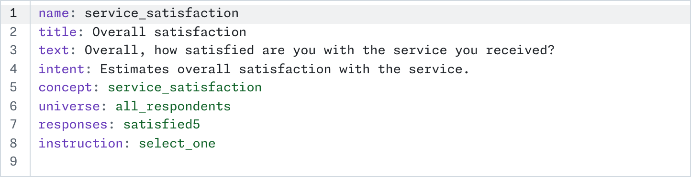
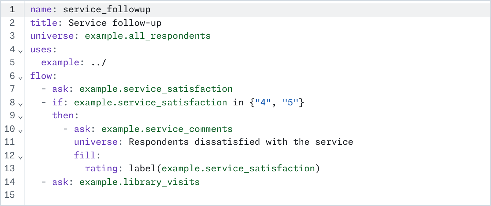

# QREtools

[](https://github.com/JHUCities/qretools/actions/workflows/pages.yml)
[](https://ddialliance.org/Specification/DDI-Lifecycle)
[](https://www.typescriptlang.org/)
[](https://react.dev/)
[](https://primer.style/)
[](https://codemirror.net/)
[](https://zod.dev/)
[](https://vite.dev/)
[](https://vitest.dev/)
[](https://biomejs.dev/)
[](https://nodejs.org/)
[](https://pnpm.io/)
[](https://workers.cloudflare.com/)

Write survey questions and instruments in the browser, and get
[DDI-Lifecycle 4.0](https://ddialliance.org/Specification/DDI-Lifecycle) out of them.

**Use it:** <https://qretools.com/>

QREtools is a question editor and instrument builder for survey teams that keep a
question bank. Each question is a short YAML file. An instrument, also YAML, puts the
bank's questions in order, with the conditions that decide who is asked what. QREtools
checks a question as you type, shows it as a respondent and a codebook would, and turns
it into DDI. The bank lives in a GitHub repository: you save to your own branch, and
your changes join the bank through a pull request.

It's built for any team with a question bank. The
[Baltimore Area Survey](https://jhucities.github.io/baltimore-area-survey-data/bas-2025/codebook.html)
(Johns Hopkins 21st Century Cities) is its first user and reference case.

## What a question looks like



## What an instrument looks like



## What a workspace looks like

A workspace is a GitHub repository of YAML files. It can hold questions, instruments or
both. An instrument can ask another workspace's questions, at a tagged version, so a
workspace may hold only instruments and draw on other teams' banks.

```text
workspace.yaml     the DDI agency, and the fields every question must have
questions/         one file per question, in folders by topic
concepts/  scales/  units/  universes/  instructions/
                   values questions share, one file each
missing.yaml       the codes for a missing answer
instruments/       one file per instrument
```

Three to look at:

- [**qretools-template**](https://github.com/JHUCities/qretools-template): start here. A
  few example questions; QREtools writes an example instrument that asks them.
- [**qretools-gss**](https://github.com/JHUCities/qretools-gss): questions only, from the
  General Social Survey's demographic and work items.
- [**qretools-tutorial**](https://github.com/JHUCities/qretools-tutorial): short lessons,
  each a question or an instrument with a gap to fill in.

## What's in it

- **The web app** (`apps/bank/`, [qretools.com](https://qretools.com/)). Write questions and
  instruments in the browser.
- **The command-line package** (`packages/cli/`, [on npm](https://www.npmjs.com/package/qretools)
  as `qretools`). Run `check`, `export`, `codebook` or `build` on a workspace, and
  `instrument check` or `instrument export` on an instrument.
- **The core package** (`packages/core/`). Reads questions and instruments, checks them,
  and turns them into DDI. Every other package uses it.
- **The codebook package** (`packages/codebook/`). Turns a DDI-Lifecycle 4.0 document into an
  HTML codebook. It also works as a `<ddi-codebook>` element on any web page.
- **The Qualtrics package** (`packages/qsf/`). Turns an instrument into a Qualtrics survey.
  Use "Download QSF" in the app, or `qretools instrument export --qsf`.
- **The editor package** (`packages/editor/`). The web app's YAML editor, built on
  CodeMirror.
- **The shell package** (`packages/shell/`). The web app's GitHub sign-in, saving, links
  and look.
- **The sign-in worker** (`worker/`). A small Cloudflare Worker that swaps GitHub's
  sign-in code for a token. It's the only part that runs on a server.

## Start a workspace

Create one from the [template](https://github.com/JHUCities/qretools-template)
("Use this template").

Install the [QREtools GitHub App](https://github.com/apps/qretools) on the repository,
then sign in at the site above with its `owner/name`. New, then Instrument, starts an
instrument. If the workspace has questions in `questions/example/`, QREtools also offers
an example instrument that asks them. The template's README walks through all of this,
including protecting `main`.

## Develop

Requires [mise](https://mise.jdx.dev/) (it pins Node and pnpm).

```sh
mise install
pnpm install
pnpm dev          # http://localhost:5199
pnpm check        # typecheck, lint, tests
pnpm build
```

The app is TypeScript, React 19 and GitHub's [Primer](https://primer.style/) design
system, with CodeMirror 6 for the editor, Zod for the question schema and ajv for DDI
validation, built with Vite and tested with Vitest. It runs entirely in the browser. It
has a functional core (`packages/core/`, `@qretools/core`: parse, check, turn into DDI,
render) and an imperative shell in the Elm style (`apps/bank/`: one Model, one `update`,
effects described as data).

Signing in with GitHub needs a GitHub App and one small Cloudflare Worker (`worker/`)
that swaps the sign-in code for a token. It's the only part that runs on a server.
`apps/bank/.env` names both. The Worker keeps its own lockfile outside the workspace:
install it with `pnpm --dir worker install`. The site deploys to
GitHub Pages from `main` (`.github/workflows/pages.yml`).

[`AGENTS.md`](AGENTS.md) records every design decision and why. Read it before
changing anything.
